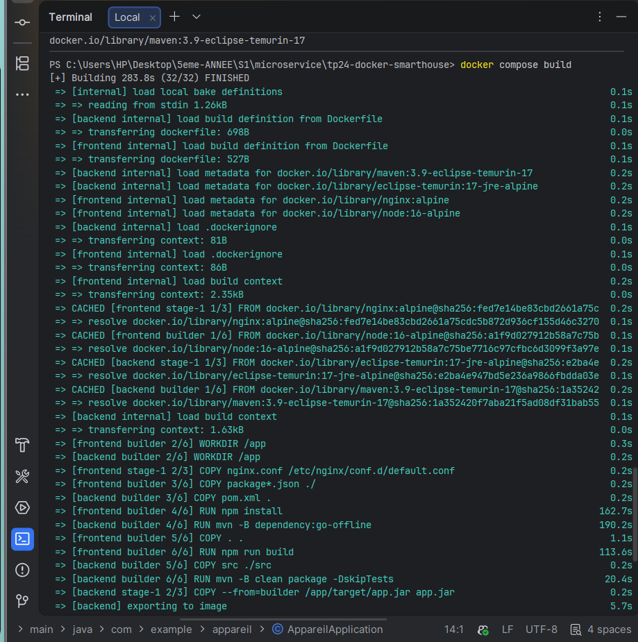
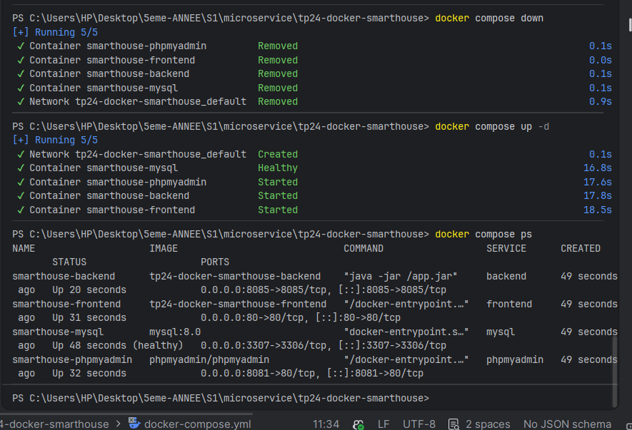
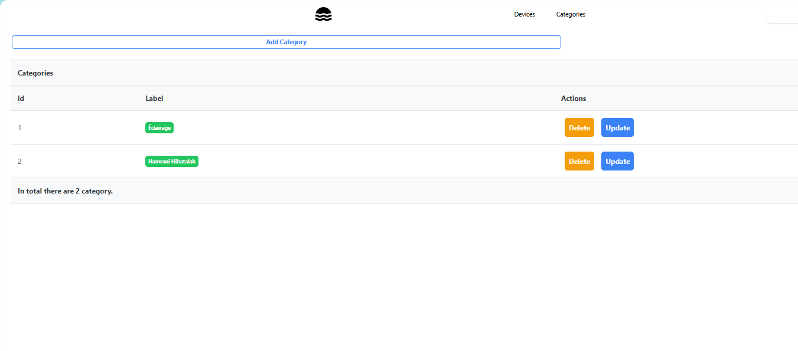
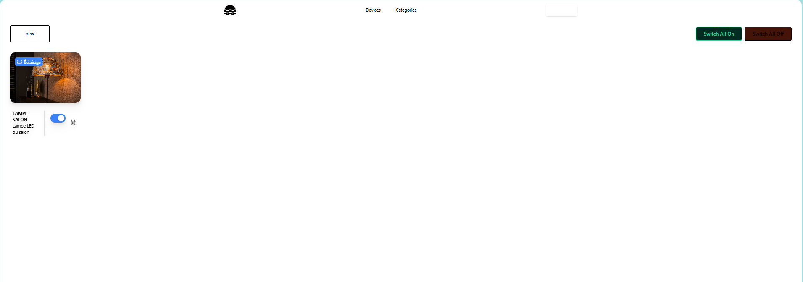
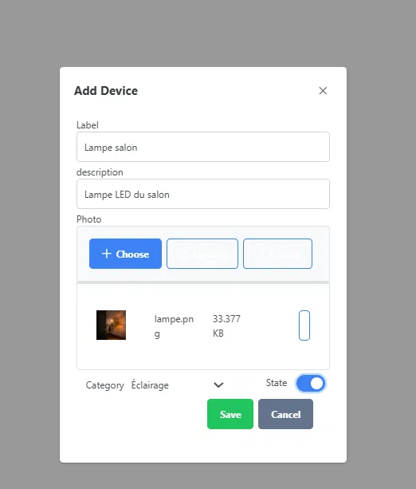
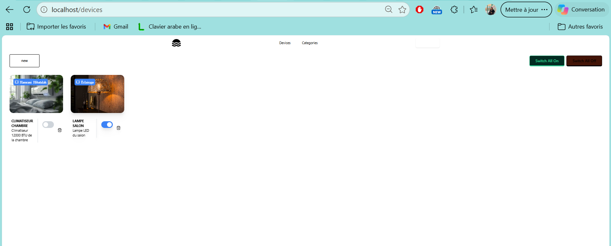
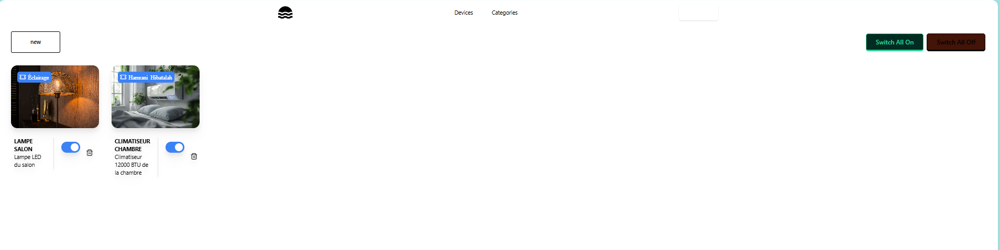
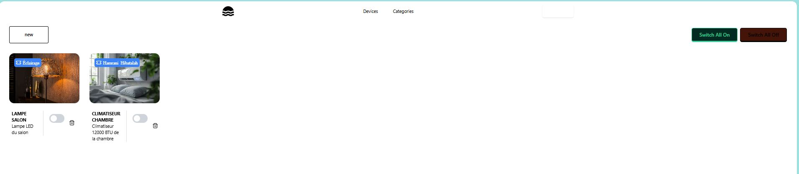
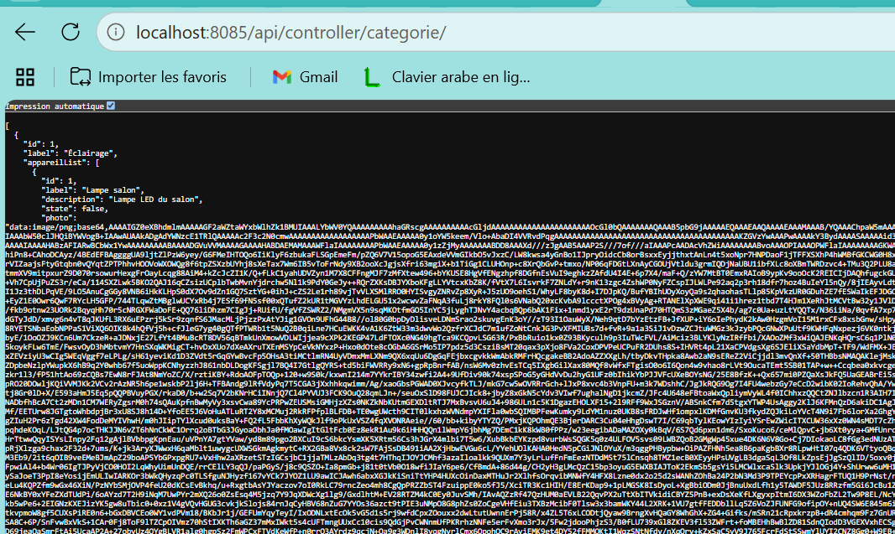

# TP 24 : Conteneurisation Spring Angular (Smart Home)

**Auteur :** Hibatalah Hamrani · EMSI Marrakech
**Cours :** Architecture Microservices : Conception, Déploiement et Orchestration

## Objectif

Conteneuriser l'application **Smart Home** (projet source : https://github.com/lachgar/smarthouse) et la lancer avec une seule commande `docker compose up`.

| Service | Image / build | Port hôte | Rôle |
|---|---|---|---|
| `mysql` | `mysql:8.0` | 3307 (→ 3306 dans le conteneur) | Base `smart-house` |
| `backend` | `./Smart_Home_back` (Spring Boot 3.1, Java 17) | 8085 | API REST `/api/controller/...` |
| `frontend` | `./smartHome-front` (Angular 14 + Nginx) | 80 | Interface web |
| `phpmyadmin` | `phpmyadmin/phpmyadmin` | 8081 | Administration MySQL |

```
 Navigateur ──► http://localhost        (frontend : Nginx + Angular)
     │
     └──────► http://localhost:8085     (backend : Spring Boot)
                       │
                       └──► mysql:3306  (réseau Docker interne)
                               ▲
 http://localhost:8081 ────────┘        (phpMyAdmin)
```

## Structure du projet

```
tp24-docker-smarthouse/
├── .env
├── docker-compose.yml
├── Smart_Home_back/
│   ├── Dockerfile
│   ├── .dockerignore
│   ├── pom.xml
│   └── src/...
└── smartHome-front/
    ├── Dockerfile
    ├── nginx.conf
    ├── .dockerignore
    ├── package.json
    └── src/...
```

## Étape 1 : Tester en local (sans Docker)

```bash
# Backend (MySQL local démarré, base smart-house)
cd Smart_Home_back
./mvnw spring-boot:run          # http://localhost:8085/api/controller/appareil/

# Frontend
cd smartHome-front
npm install
npm start                       # http://localhost:4200
```

## Étapes 2 à 6 : Docker

```bash
docker compose build      # étape 3 : construire les images
docker compose up -d      # étape 4 : lancer les conteneurs
docker compose ps         # étape 5 : vérifier que les 4 conteneurs sont "running"/"healthy"
```

Étape 6 : accéder à l'application :
- Frontend : http://localhost
- API : http://localhost:8085/api/controller/appareil/ et http://localhost:8085/api/controller/categorie/
- phpMyAdmin : http://localhost:8081 (utilisateur `root`, mot de passe `root`)

Arrêter : `docker compose down` (ajouter `-v` pour supprimer aussi les données MySQL).

> Avec l'ancienne version de Docker, remplacer `docker compose` par `docker-compose`.

> **Port MySQL :** le port hôte est `3307` (et non `3306`) car un MySQL local occupait déjà le 3306 sur la machine. À l'intérieur du réseau Docker, le backend et phpMyAdmin utilisent toujours `mysql:3306`.

## Captures d'écran

### 1. Construction des images : `docker compose build`

Les deux images (`backend` et `frontend`) sont construites en multi-stage : `npm install` + `npm run build` pour Angular, `mvn dependency:go-offline` + `mvn clean package -DskipTests` pour Spring Boot, puis copie du résultat dans l'image finale (`COPY --from=builder`).



### 2. Lancement et état des conteneurs : `docker compose up -d` puis `docker compose ps`

MySQL passe d'abord à l'état **Healthy**, puis le backend, le frontend et phpMyAdmin démarrent. Les 4 conteneurs sont `Up`, avec les ports publiés 8085, 80, 3307 et 8081.



### 3. Frontend : gestion des catégories (http://localhost/category)

Ajout et modification (bouton **Update**) des catégories, enregistrées dans MySQL.



### 4. Frontend : premier appareil enregistré (http://localhost/devices)



### 5. Formulaire d'ajout d'un appareil

Label, description, photo (convertie en base64), catégorie et état.



### 6. Liste des appareils (un allumé, un éteint)



### 7. Test « Switch All On »

Tous les appareils passent à l'état allumé (`GET /api/controller/appareil/update/state/true`).



### 8. Test « Switch All Off »

Tous les appareils passent à l'état éteint (`GET /api/controller/appareil/update/state/false`).



### 9. API backend : http://localhost:8085/api/controller/categorie/

Le backend dans Docker renvoie les catégories avec leurs appareils (`appareilsList`). Le champ `photo` contient l'image encodée en base64 (colonne `LONGTEXT` dans MySQL), d'où la longueur du JSON.



## Analyse de l'énoncé et corrections apportées

Les fichiers donnés dans l'énoncé ne fonctionnent pas tels quels. Voici ce qui a été corrigé, et pourquoi.

### Dockerfile backend

| Énoncé | Problème | Correction |
|---|---|---|
| `COPY ${JAR_FILE} app.jar` dans le stage 2 | Copie le JAR depuis **la machine hôte**, pas depuis le stage `builder`. Le build Maven du stage 1 ne sert à rien, et ça échoue si on n'a pas fait `mvn package` avant. | `COPY --from=builder /app/target/app.jar app.jar` |
| `RUN mvn clean package` | Lance les tests : `contextLoads()` essaie de se connecter à MySQL, qui n'existe pas pendant le build → échec. | `mvn clean package -DskipTests` |
| `FROM openjdk:17-jdk-alpine` | Les images `openjdk` sont dépréciées et ce tag n'est plus disponible. | `eclipse-temurin:17-jre-alpine` (JRE seulement, image plus légère) |
| `maven:3.8.4-openjdk-17` | Image basée sur `openjdk` (dépréciée). | `maven:3.9-eclipse-temurin-17` |

Bonus : le `pom.xml` est copié avant `src`, avec `dependency:go-offline`, pour que Docker garde les dépendances en cache entre deux builds.

### Dockerfile frontend

| Énoncé | Problème | Correction |
|---|---|---|
| `node:14.15.0-alpine` | Limite basse pour Angular 14 ; certaines dépendances récentes (Tailwind, PostCSS) posent problème. | `node:16-alpine` (supporté par Angular 14) |
| `COPY . .` puis `npm install` | Copie aussi `node_modules` local s'il existe, et casse le cache. | `.dockerignore` + copie de `package*.json` d'abord |
| Pas de config Nginx | Rafraîchir `/devices` ou `/category` donne une **404 Nginx** (application SPA). | `nginx.conf` avec `try_files $uri $uri/ /index.html` |

Le chemin `dist/smart-home` est correct (`outputPath` dans `angular.json`). Le build Angular a été vérifié (`ng build` OK ; seul un avertissement de budget de taille, sans impact).

### docker-compose.yml

| Énoncé | Problème | Correction |
|---|---|---|
| `healthcheck` placé sur **backend** avec `/usr/bin/mysql` | Le client `mysql` n'existe pas dans le conteneur backend : le healthcheck échoue toujours. Et il ne sert pas à faire attendre le backend. | Healthcheck déplacé sur **mysql** (`mysqladmin ping`) + `depends_on: condition: service_healthy` |
| `condition: service_started` pour MySQL | MySQL démarre mais n'accepte pas encore de connexions → le backend plante au démarrage. | `service_healthy` + `restart: on-failure` |
| `mysql:latest` | Version qui peut changer d'un jour à l'autre. | `mysql:8.0` (version fixe) |
| URL JDBC simple | MySQL 8 + connexion sans SSL → erreur `Public Key Retrieval is not allowed`. | `?useSSL=false&allowPublicKeyRetrieval=true&serverTimezone=UTC` |
| Pas de volume | Les données sont perdues à chaque `docker compose down`. | Volume nommé `mysql-data` |
| `version: '3'` | Obsolète avec Docker Compose v2 (avertissement). | Supprimé |

### Bug corrigé dans le frontend

Après un ajout, le formulaire « Add Device » (et « Add Category ») se rouvrait avec les valeurs du dernier élément enregistré : le composant réutilisait le même objet `newAppareil` / `newCategorie`. Correction : l'objet est recréé à chaque ouverture du formulaire, et la photo choisie est vidée (`FileUpload.clear()`) dans `list-appareil.component.ts` et `categories.component.ts`.

### Configuration Spring Boot (point demandé à l'étape 6)

`application.properties` garde `localhost` pour le lancement en local. Dans Docker, les variables `SPRING_DATASOURCE_URL`, `SPRING_DATASOURCE_USERNAME` et `SPRING_DATASOURCE_PASSWORD` du `docker-compose.yml` **remplacent** ces valeurs. Le backend utilise donc `mysql` (nom du service Docker) au lieu de `localhost`.

Le frontend appelle `http://localhost:8085/api/controller/` : c'est le navigateur (sur la machine hôte) qui fait l'appel, donc `localhost:8085` fonctionne grâce au port publié par le conteneur backend. Les contrôleurs ont déjà `@CrossOrigin`, donc pas de problème de CORS.

## Dépannage

| Symptôme | Cause / solution |
|---|---|
| `port is already allocated` (3306, 80 ou 8081) | Un MySQL/serveur local tourne déjà : l'arrêter ou changer le port hôte (ex. `"3307:3306"`). |
| Backend redémarre en boucle | `docker compose logs backend` ; vérifier que `mysql` est `healthy`. |
| Page blanche sur http://localhost | `docker compose logs frontend` ; vérifier le chemin `dist/smart-home`. |
| Liste vide dans le front | Normal au premier lancement : ajouter une catégorie puis un appareil. |
